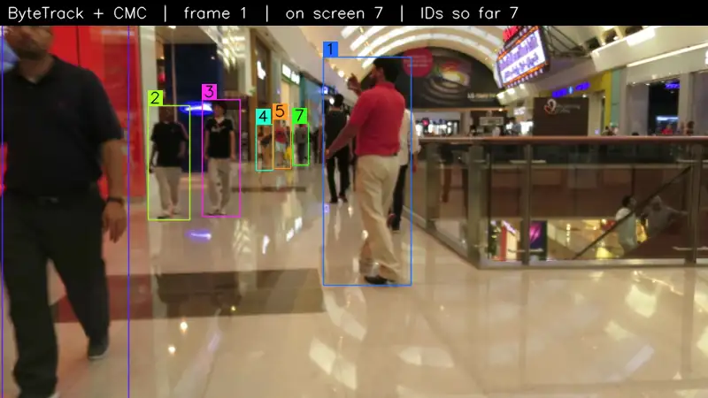
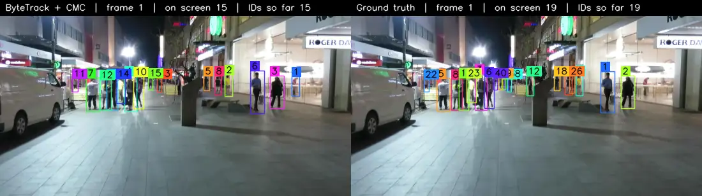

# evs-mot-bytetrack

Multi-object pedestrian tracking on top of a fixed set of detections. The
tracker is a from-scratch implementation of **ByteTrack** with a Kalman filter,
extended with **camera motion compensation**, **predict-fill** for briefly lost
tracks, and **linear gap interpolation**.

It scored **MOTA 44.02%** on the hidden test set (course evaluation server).

<p align="center">
  
</p>

## Demo

**Tracker vs ground truth** on training sequence MOT_05 (handheld camera, at night, crowded):

<p align="center">
  
</p>

Full-length videos:

| Sequence | Split | Video |
|---|---|---|
| MOT_01 | test | [MOT_01.mp4](assets/videos/MOT_01.mp4) |
| MOT_06 | test | [MOT_06.mp4](assets/videos/MOT_06.mp4) |
| MOT_07 | test | [MOT_07.mp4](assets/videos/MOT_07.mp4) |
| MOT_05 | train, side by side with GT | [compare_MOT_05.mp4](assets/videos/compare_MOT_05.mp4) |

Each box is drawn with its track ID, and the line under it is the track's recent trajectory.

## How it works

```
det.txt ──► Kalman predict ──► CMC warp ──► BYTE association ──► predict-fill ──► interpolation ──► MOT .txt
                               (LK flow +    (high dets → tracks,  (≤ 8 frames)     (gaps ≤ 60)
                                RANSAC)       low dets → leftovers)
```

1. **Kalman filter.** The state is `[cx, cy, w, h, vx, vy, vw, vh]`, and the process and measurement noise scale with box height (DeepSORT-style).
2. **Camera motion compensation.** It tracks Shi-Tomasi corners on the background (detections are masked out) with Lucas-Kanade optical flow, fits a RANSAC affine transform, and warps every track's mean and covariance with it. Most sequences are shot with a handheld or vehicle-mounted camera, so without CMC the predictions drift away from the detections and ID switches pile up.
3. **BYTE association.** Matching runs in three Hungarian rounds on `1 − IoU`:
   - high-confidence detections against tracked and lost tracks, with score fusion,
   - low-confidence detections against the tracks still unmatched, which keeps people alive through occlusion,
   - the remaining high detections against unconfirmed tracks.
4. **Predict-fill.** For tracks lost 1–8 frames ago, the Kalman prediction is emitted as output. The detector covers only about 30–50% of GT boxes per frame, so short gaps are usually missed detections, not people leaving the scene.
5. **Interpolation.** After the whole sequence is tracked, gaps of up to 60 frames inside a track are filled linearly. Since the track exists on both sides of the gap, these boxes are almost always true positives.

A detailed write-up in Polish is in [docs/jak_dziala.md](docs/jak_dziala.md), and summaries of the papers it builds on (SORT, ByteTrack, BoT-SORT, CLEAR MOT) are in [docs/articles.md](docs/articles.md).

## Results

The test set ground truth is hidden, so the test score comes from the evaluation server. Train scores are computed locally with TrackEval's CLEAR metric at IoU 0.5.

| Split | MOTA | MOTP | Recall | Precision | IDSW |
|---|---|---|---|---|---|
| **test** (MOT_01, 06, 07) | **44.02** | – | – | – | – |
| train MOT_02 | 27.3 | 89.5 | 27.5 | 99.6 | 26 |
| train MOT_03 | 42.4 | 82.2 | 50.0 | 87.4 | 32 |
| train MOT_04 | 31.1 | 89.7 | 32.4 | 96.7 | 21 |
| train MOT_05 | 39.6 | 83.0 | 51.4 | 82.5 | 141 |
| train (aggregate) | 29.9 | 87.6 | 32.0 | 94.4 | 220 |

Precision is high and recall is low, which shows the bottleneck is detector coverage, not association. That is why the extensions above all aim to recover recall.

## Usage

Requires [uv](https://docs.astral.sh/uv/). Put the dataset in `data/` first (see [data/README.md](data/README.md)).

```bash
# Generate test-set predictions (reproduces results/test/ byte for byte)
uv run python tracker/track_all.py data/evs_mot_public_dataset/evs_mot-test results/test \
  --cmc --predict-lost-frames 8 \
  --track-thresh 0.6 --new-track-thresh 0.7 --match-thresh 0.9 \
  --track-buffer 60 --interpolate --max-gap 60

# Same config on the train set + CLEAR metrics
uv run python tracker/eval_train.py \
  --cmc --predict-lost-frames 8 \
  --track-thresh 0.6 --new-track-thresh 0.7 --match-thresh 0.9 \
  --track-buffer 60 --interpolate --max-gap 60

# Score a single file
uv run python tools/run_clear.py data/evs_mot_public_dataset/evs_mot-train/MOT_04/gt/gt.txt results/train/MOT_04.txt

# Render a demo video (.mp4 / .gif / .webp), optionally next to GT
uv run python tools/make_demo.py --sequence MOT_05 --mot-file results/train/MOT_05.txt \
  --gt --out outputs/MOT_05.mp4

# Interactive player (space = pause, n/p = step, +/- = speed)
uv run python tools/visualize_live.py --sequence MOT_05 --mot-file results/train/MOT_05.txt
```

The default flag values in `track_all.py` are the plain ByteTrack defaults, so always pass the flags above to reproduce the result.

## Repository layout

```
tracker/       ByteTrack, Kalman filter, CMC, matching, interpolation, CLI entry points
tools/         CLEAR evaluation, visualizers, demo renderer
results/       tracker output in MOTChallenge format (test = submitted, train = local eval)
assets/        demo animations and videos
docs/          task description, method write-up, paper summaries (Polish)
third_party/   TrackEval (MIT, Jonathon Luiten), used for the CLEAR metrics
data/          dataset goes here (not included)
```

## Authors

Konrad Małek, Bartłomiej Mazgaj. This was a university project for a computer vision course.

## References

- Zhang et al., *ByteTrack: Multi-Object Tracking by Associating Every Detection Box*, ECCV 2022
- Bewley et al., *Simple Online and Realtime Tracking*, ICIP 2016
- Aharon et al., *BoT-SORT: Robust Associations Multi-Pedestrian Tracking*, 2022
- Bernardin & Stiefelhagen, *Evaluating Multiple Object Tracking Performance: The CLEAR MOT Metrics*, 2008
- [TrackEval](https://github.com/JonathonLuiten/TrackEval)
